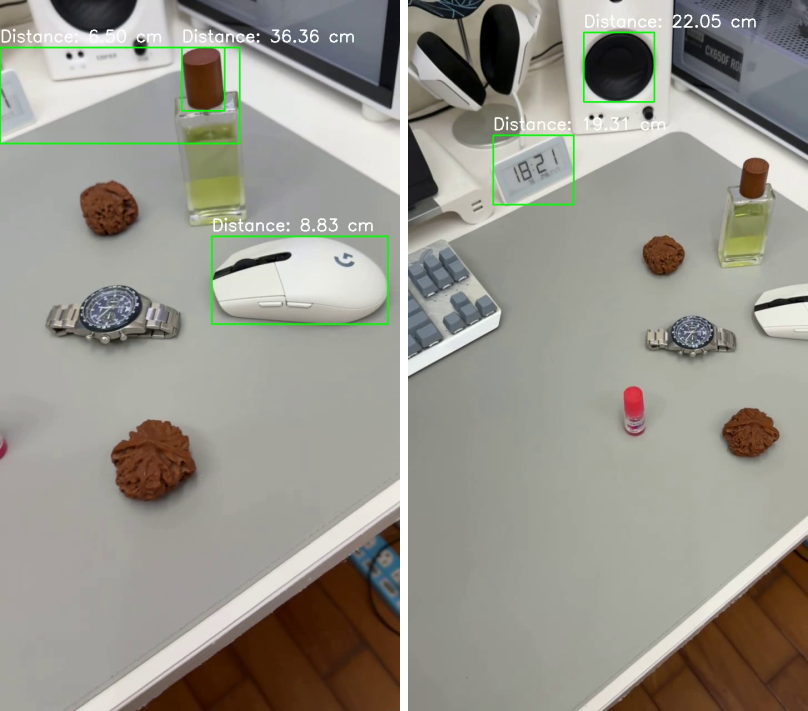
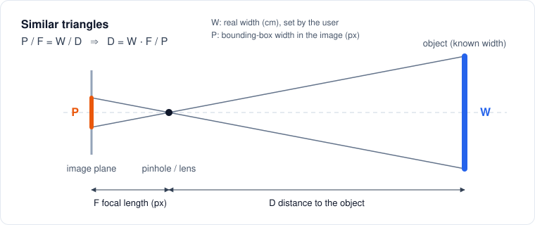
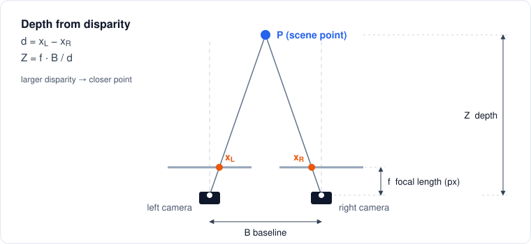

# Vision-Based Distance Estimation

Estimating how far away things are with cameras: monocular similar triangles, MiDaS monocular depth, stereo disparity, and an Intel RealSense depth camera, all in Python and OpenCV.


[English](#english) | [中文](#中文)

<p align="center"></p>

---

## English

### Overview

These are computer-vision experiments I wrote in Fall 2024 during my undergraduate capstone project (畢業專題) at Yuan Ze University. They are separate from the capstone's final deliverable, which covers a different topic. I tried several camera-based ways of estimating distance:

| Family | Idea | Script(s) |
|---|---|---|
| **Monocular, geometric** | One camera plus a known object width; distance from the pinhole model (similar triangles) | `monocular/similar_triangles_{webcam,image,video}.py` |
| **Monocular, learned** | One camera plus a pretrained network (MiDaS) that predicts a dense relative depth map | `monocular/midas_depth_{readout,video}.py` |
| **Stereo** | Two cameras a known baseline apart; depth from the disparity between the views | `stereo/stereo_bm_video.py`, `stereo/stereo_sgbm_live.py` |
| **Active depth sensor** | Intel RealSense camera that measures depth in hardware | `depth_camera/realsense_center_distance.py` |

All scripts are short and self-contained, so you can read the whole pipeline of each method in one file. Every hard-coded path in the original code is now a command-line argument. The algorithms are unchanged.

### Methods

#### 1. Monocular: similar triangles (pinhole model)

<p align="center"></p>

For a pinhole camera, an object of real width **W** at distance **D** appears **P** pixels wide on a sensor at focal length **F** (in pixels): `P / F = W / D`, so

```
D = W · F / P
```

Pipeline in each script: grayscale → Canny edges (50/150) → `findContours` → `boundingRect`. The box width is used as **P**, and the distance is drawn on the image.

| Script | Input | Default W / F | Which boxes are labelled |
|---|---|---|---|
| `similar_triangles_webcam.py` | webcam | 20 cm / 600 px | boxes every contour, but all labels are drawn at the same top-left spot and overlap (first prototype) |
| `similar_triangles_image.py` | image | 20 cm / 130 px | the 3 contours with the **smallest estimated distance** |
| `similar_triangles_video.py` | video | 4 cm / 700 px | the 3 contours with the **largest area**; can save the annotated video |

**Calibrating F:** place the reference object at a known distance D, measure its width P in pixels, then `F = P · D / W`. The defaults above are hand-set values from the original code. The original comments say F can come from camera calibration or an empirical value, but the sources contain no calibration procedure.

#### 2. Monocular: MiDaS depth estimation

[MiDaS](https://github.com/isl-org/MiDaS) is loaded through `torch.hub` (`DPT_Large` by default, `MiDaS_small` optional). Each frame is converted to RGB, transformed, and passed through the network. The resulting map is min-max normalised to 0–255 and colour-mapped with `COLORMAP_MAGMA`.

- `midas_depth_readout.py` (v1) puts the frame and the depth map side by side. It also draws on the frame the mean of the central 40 × 40 region of the depth map multiplied by an empirical `--depth-scale` (default 0.1).
- `midas_depth_video.py` (v2) refactors the model into a `DepthEstimator` class and can write the side-by-side result to a video (`--output`).

MiDaS predicts **relative inverse depth**, so larger values mean closer. Each frame is also normalised separately. The v1 read-out is therefore an uncalibrated indicator and not a metric distance.

#### 3. Stereo: depth from disparity

<p align="center"></p>

With two parallel cameras separated by a baseline **B**, a point appears at `x_L` and `x_R` in the two images. Its disparity `d = x_L − x_R` gives its depth:

```
Z = f · B / d
```

| Script | Input | Matcher | Defaults |
|---|---|---|---|
| `stereo_bm_video.py` | left + right video files | `StereoBM` (numDisparities 16, blockSize 15) | f = 800 px, B = 0.1 m. Distances between 0 and 10 m are drawn on the left frame on a 50 px grid. Disparity and depth maps are shown alongside. |
| `stereo_sgbm_live.py` | two webcams (index 0 and 1) | `StereoSGBM` (numDisparities 80, blockSize 5, P1 = 8·3·5², P2 = 32·3·5²) | f = 800 px, B = 100 mm. Shows both views and the disparity map. |

#### 4. Depth camera: Intel RealSense

`realsense_center_distance.py` streams depth (z16) and colour (bgr8) at 640 × 480 @ 30 fps through `pyrealsense2`. It reads the distance at the image centre with `depth_frame.get_distance()` (metres) and draws it on the colour image, next to a JET colour map of the depth frame. The stream setup and depth colour-mapping code is adapted from the Intel RealSense SDK example `opencv_viewer_example.py` (Apache-2.0; see Credits).

### Results

This was an exploratory study. The source project contains **no quantitative accuracy evaluation**, so this README reports no accuracy numbers.

**Sample output: similar triangles on a video.** The two frames below (frames 210 and 400) come from `output_video.mp4`. The original `距離判斷_影片2.py`, now `monocular/similar_triangles_video.py`, wrote that video from a 720 × 1280 clip of a desk. Frames are scaled to 400 px wide.

<p align="center"></p>

The labels use the script defaults **W = 4 cm** and **F = 700 px** for every box, so they are **not measured distances**. Each box is one of the three largest-area contours in the frame, for example around the mouse, the bottle cap, the speaker or the clock. Because every contour is treated as a 4 cm-wide object, a narrower box gets a larger distance: for example, the 77 px-wide cap box reads 36.36 cm and the 317 px-wide mouse box reads 8.83 cm. This illustrates the "contours are not objects" limitation below.

The other scripts produce live visual output:

| Script | What you see |
|---|---|
| similar-triangles scripts | Green bounding boxes with `Distance: xx.xx cm` labels |
| `midas_depth_readout.py` | Frame and MAGMA depth map side by side, with a centre read-out |
| `midas_depth_video.py` | Frame and MAGMA depth map side by side, optionally saved as a video |
| `stereo_bm_video.py` | Left frame with a grid of distances in metres, plus disparity and depth maps |
| `stereo_sgbm_live.py` | Left and right views and a normalised disparity map |
| `realsense_center_distance.py` | Colour image with the centre distance in metres, plus the JET depth map |

The original project folder also had the test videos and a MiDaS side-by-side output video. The MiDaS file is truncated and cannot be decoded, so no MiDaS frame is shown. Video files are not included in this repository.

### Limitations and notes

These follow directly from the code and are worth knowing before you reuse it:

- **Hand-set constants.** Focal lengths, object widths and baselines are fixed values in the code. Accurate distances need camera calibration, e.g. with `cv2.calibrateCamera`.
- **Contours are not objects.** The similar-triangles scripts apply the known width W to any edge contour, so only the box around the actual reference object gives a meaningful distance.
- **Overlapping labels in the webcam prototype.** `similar_triangles_webcam.py` draws every distance label at the fixed position (10, 30), so the labels overlap and cannot be matched to their boxes.
- **No stereo rectification.** `StereoBM` and `StereoSGBM` assume rectified image pairs, but the scripts use raw frames.
- **Depth range of the BM settings.** With `numDisparities=16` the disparity stays below 16 px. With f = 800 px and B = 0.1 m that means Z > 800 × 0.1 / 16 = 5 m, so the 0–10 m labels only appear for roughly 5–10 m. Increase `--num-disparities` for closer scenes.
- **RealSense alignment.** The depth and colour streams are not aligned (`rs.align` is not used), so the centre marker on the colour image is approximate.

### Project structure

```
vision-distance-estimation/
├── monocular/
│   ├── similar_triangles_webcam.py   # live webcam, pinhole model (prototype)
│   ├── similar_triangles_image.py    # single image, 3 closest contours
│   ├── similar_triangles_video.py    # video file, 3 largest contours, optional export
│   ├── midas_depth_readout.py        # MiDaS depth + centre read-out (v1)
│   └── midas_depth_video.py          # MiDaS depth, class-based, video export (v2)
├── stereo/
│   ├── stereo_bm_video.py            # StereoBM on left/right videos, distance grid
│   └── stereo_sgbm_live.py           # StereoSGBM on two live webcams
├── depth_camera/
│   └── realsense_center_distance.py  # Intel RealSense centre distance
├── assets/
│   ├── similar-triangles.svg         # geometry diagram
│   ├── stereo-disparity.svg          # geometry diagram
│   └── similar_triangles_video_result.png  # sample output frames
├── requirements.txt                  # OpenCV + NumPy (all scripts)
├── requirements-midas.txt            # + PyTorch / MiDaS
├── requirements-realsense.txt        # + pyrealsense2
├── LICENSE
└── README.md
```

#### Original file names and version history

The scripts were written between October and November 2024 (per file dates). Earlier versions that a later file fully replaced are not included.

| Original file (中文檔名) | In this repo | Notes |
|---|---|---|
| 距離判斷_單眼.py | `monocular/similar_triangles_webcam.py` | first prototype, live webcam |
| 距離判斷_圖片.py | *(superseded)* | v1: labelled the 3 largest-area contours |
| 距離判斷_圖片2.py | `monocular/similar_triangles_image.py` | v2: labels the 3 closest contours |
| 距離判斷_影片.py | *(superseded)* | v1: display only |
| 距離判斷_影片2.py | `monocular/similar_triangles_video.py` | v2: adds video export |
| 距離判斷_單目深度估計.py | `monocular/midas_depth_readout.py` | v1: centre-region read-out |
| 距離判斷_單目深度估計2.py | `monocular/midas_depth_video.py` | v2: class refactor and video export (no read-out) |
| 距離判斷_雙眼.py | `stereo/stereo_sgbm_live.py` | live two-camera SGBM |
| 距離判斷_影片_雙眼.py | *(superseded)* | v1: raw left/right frames plus disparity and depth maps, no distance grid; baseline 0.08 m |
| 距離判斷_影片_雙眼2.py | `stereo/stereo_bm_video.py` | v2: distance grid, baseline 0.1 m |
| 距離判斷_深度相機.py | `depth_camera/realsense_center_distance.py` | Intel RealSense |

Two other files from the folder are not included: `aa.py`, an identical copy of 距離判斷_深度相機.py, and `測試1.py`, a test that only displays an image.

### Getting started

```bash
git clone https://github.com/ShengWei0528/vision-distance-estimation.git
cd vision-distance-estimation
python -m venv .venv
# Windows: .venv\Scripts\activate    macOS/Linux: source .venv/bin/activate

pip install -r requirements.txt            # similar-triangles and stereo scripts
pip install -r requirements-midas.txt      # + MiDaS scripts (PyTorch, timm)
pip install -r requirements-realsense.txt  # + RealSense script (pyrealsense2)
```

Install only the files you need. Run any script with `--help` to see its options. Press **q** in an OpenCV window to quit.

```bash
# Monocular, similar triangles
python monocular/similar_triangles_webcam.py --camera 0 --known-width 20 --focal-length 600
python monocular/similar_triangles_image.py path/to/photo.jpg --known-width 20 --focal-length 130
python monocular/similar_triangles_video.py path/to/video.mp4 --output annotated.mp4

# Monocular, MiDaS (first run downloads the model through torch.hub)
python monocular/midas_depth_readout.py path/to/video.mp4 --model MiDaS_small
python monocular/midas_depth_video.py path/to/video.mp4 --output output_depth.mp4

# Stereo
python stereo/stereo_bm_video.py left.mp4 right.mp4 --baseline 0.1 --focal-length 800
python stereo/stereo_sgbm_live.py --left-camera 0 --right-camera 1 --baseline 100

# Depth camera (Intel RealSense connected)
python depth_camera/realsense_center_distance.py
```

### Tech stack

Python 3 · OpenCV (Canny, contours, StereoBM, StereoSGBM, VideoWriter) · NumPy · PyTorch and `torch.hub` (MiDaS) · Intel RealSense SDK 2.0 (`pyrealsense2`)

### Context

- **Course:** Exploratory work during the Undergraduate Capstone Project (畢業專題). This is not the capstone's final deliverable.
- **School:** Department of Electrical Engineering, Yuan Ze University (元智大學電機工程學系)
- **Period:** Fall 2024 (October–November)
- **Author:** Sheng-Wei Lu (呂聖韡)

### Credits

- **MiDaS** by Intel ISL: [github.com/isl-org/MiDaS](https://github.com/isl-org/MiDaS) (MIT License). R. Ranftl et al., *Towards Robust Monocular Depth Estimation: Mixing Datasets for Zero-shot Cross-dataset Transfer*, TPAMI 2022, and R. Ranftl, A. Bochkovskiy, V. Koltun, *Vision Transformers for Dense Prediction*, ICCV 2021. Model weights are downloaded at runtime and are not redistributed here.
- **OpenCV** (Apache 2.0): `StereoBM` and `StereoSGBM`. SGBM is based on H. Hirschmüller, *Stereo Processing by Semiglobal Matching and Mutual Information*, TPAMI 2008.
- **Intel RealSense SDK 2.0**: [github.com/IntelRealSense/librealsense](https://github.com/IntelRealSense/librealsense) (Apache 2.0). In `realsense_center_distance.py`, the stream setup and depth colour-mapping are adapted from the SDK's Python example `wrappers/python/examples/opencv_viewer_example.py` (Apache License 2.0).
- The similar-triangles idea follows the classic approach described in PyImageSearch's tutorial [*Find distance from camera to object/marker using Python and OpenCV*](https://pyimagesearch.com/2015/01/19/find-distance-camera-objectmarker-using-python-opencv/) (A. Rosebrock, 2015).
- The sample frames in `assets/similar_triangles_video_result.png` are from my own recording.

### License

Code, diagrams and the sample figure are released under the [MIT License](LICENSE). Portions adapted from third-party examples (see Credits) remain under their original licenses.

---

## 中文

### 專案簡介

這是我在 2024 年秋季、元智大學畢業專題期間撰寫的電腦視覺實驗程式，嘗試用攝影機估計物體距離。這些程式與畢業專題的最終成果（另一個主題）是分開的。我試過以下幾類方法：

| 類別 | 原理 | 程式 |
|---|---|---|
| **單眼：幾何法** | 單一相機加上已知物體寬度，用針孔相機模型（相似三角形）計算距離 | `monocular/similar_triangles_{webcam,image,video}.py` |
| **單眼：深度學習** | 單一相機加上預訓練網路 MiDaS，預測整張影像的相對深度圖 | `monocular/midas_depth_{readout,video}.py` |
| **雙眼立體視覺** | 兩台相機相距已知基線，用左右影像的視差計算深度 | `stereo/stereo_bm_video.py`、`stereo/stereo_sgbm_live.py` |
| **主動式深度相機** | Intel RealSense 以硬體直接量測深度 | `depth_camera/realsense_center_distance.py` |

每支程式都短小且獨立，一個檔案就能看完該方法的完整流程。原始程式中寫死的路徑已全部改成命令列參數，演算法本身未做更動。

### 方法說明

#### 1. 單眼：相似三角形（針孔相機模型）

<p align="center"></p>

實際寬度為 **W** 的物體位於距離 **D** 處時，在焦距 **F**（像素）的感測器上會呈現 **P** 像素寬。由 `P / F = W / D` 可得：

```
D = W · F / P
```

處理流程：灰階 → Canny 邊緣偵測（50/150）→ `findContours` → `boundingRect`，以外框寬度作為 **P**，並把距離標示在影像上。

| 程式 | 輸入 | 預設 W / F | 標示哪些外框 |
|---|---|---|---|
| `similar_triangles_webcam.py` | 網路攝影機 | 20 cm / 600 px | 每個輪廓都畫框，但所有距離標籤都畫在左上角同一位置而互相重疊（第一版雛形） |
| `similar_triangles_image.py` | 圖片 | 20 cm / 130 px | **估計距離最近**的 3 個輪廓 |
| `similar_triangles_video.py` | 影片 | 4 cm / 700 px | **面積最大**的 3 個輪廓，可輸出標註後影片 |

**焦距校正方式：** 將參考物放在已知距離 D，量出它在影像中的像素寬 P，再由 `F = P · D / W` 求出 F。上表的預設值是原始程式中手動設定的數值。原始註解寫焦距「可以透過相機標定得到，或者使用經驗值」，但原始資料中並沒有校正流程。

#### 2. 單眼：MiDaS 深度估計

透過 `torch.hub` 載入 [MiDaS](https://github.com/isl-org/MiDaS)，預設為 `DPT_Large`，也可改用 `MiDaS_small`。每張影格轉成 RGB 並經前處理後送入網路，輸出結果以 min-max 正規化到 0–255，再套用 `COLORMAP_MAGMA` 上色。

- `midas_depth_readout.py`（v1）：原圖與深度圖並排顯示，並把深度圖中央 40 × 40 區域的平均值乘上經驗比例 `--depth-scale`（預設 0.1）後畫在畫面上。
- `midas_depth_video.py`（v2）：把模型重構成 `DepthEstimator` 類別，可將並排結果輸出成影片（`--output`）。

MiDaS 輸出的是**相對的逆深度**（數值越大代表越近），而且每張影格各自正規化，所以 v1 顯示的數值只是未校正的指標，並非真實的公制距離。

#### 3. 雙眼立體視覺：由視差求深度

<p align="center"></p>

兩台平行相機相距基線 **B**，同一點在左右影像中的位置為 `x_L`、`x_R`，視差為 `d = x_L − x_R`，深度為：

```
Z = f · B / d
```

| 程式 | 輸入 | 匹配器 | 預設參數 |
|---|---|---|---|
| `stereo_bm_video.py` | 左、右兩支影片 | `StereoBM`（numDisparities 16、blockSize 15） | f = 800 px、B = 0.1 m。在左影像上每 50 px 標示 0–10 m 範圍內的距離，同時顯示視差圖與深度圖 |
| `stereo_sgbm_live.py` | 兩台網路攝影機（編號 0、1） | `StereoSGBM`（numDisparities 80、blockSize 5、P1 = 8·3·5²、P2 = 32·3·5²） | f = 800 px、B = 100 mm。顯示左右畫面與視差圖 |

#### 4. 深度相機：Intel RealSense

`realsense_center_distance.py` 透過 `pyrealsense2` 以 640 × 480 @ 30 fps 開啟深度（z16）與彩色（bgr8）串流，用 `depth_frame.get_distance()` 讀取畫面中心點的距離（公尺）並標在彩色影像上，旁邊並排顯示 JET 上色的深度圖。串流設定與深度上色的程式碼改寫自 Intel RealSense SDK 範例 `opencv_viewer_example.py`（Apache-2.0，見致謝與引用）。

### 成果

這是探索性質的研究，原始專案中**沒有做定量的準確度評估**，因此本文件不列任何準確度數字。

**範例輸出：影片上的相似三角形法。** 下圖是 `output_video.mp4` 的第 210 與第 400 張影格。這支影片由原始程式 `距離判斷_影片2.py`（即本儲存庫的 `monocular/similar_triangles_video.py`）處理一段 720 × 1280 的桌面影片後輸出，圖中影格已縮放為 400 px 寬。

<p align="center"></p>

所有外框的標籤都使用程式預設值 **W = 4 cm**、**F = 700 px** 計算，因此**不是實際量測的距離**。每個外框是該影格中面積最大的 3 個輪廓之一，例如框住滑鼠、瓶蓋、喇叭或時鐘的外框。因為每個輪廓都被當成 4 cm 寬的物體，外框越窄，算出的距離就越遠：例如寬 77 px 的瓶蓋框顯示 36.36 cm，寬 317 px 的滑鼠框顯示 8.83 cm。這正是下方「輪廓不等於物體」限制的例子。

其他程式的輸出都是即時的視覺化結果：

| 程式 | 畫面內容 |
|---|---|
| 相似三角形系列 | 綠色外框與 `Distance: xx.xx cm` 標籤 |
| `midas_depth_readout.py` | 原圖與 MAGMA 深度圖並排，附中央區域讀值 |
| `midas_depth_video.py` | 原圖與 MAGMA 深度圖並排，可存成影片 |
| `stereo_bm_video.py` | 左影像上以網格標示距離（公尺），另顯示視差圖與深度圖 |
| `stereo_sgbm_live.py` | 左右畫面與正規化後的視差圖 |
| `realsense_center_distance.py` | 彩色影像中心距離（公尺）與 JET 深度圖 |

原始專案資料夾中另有測試影片與一支 MiDaS 並排深度輸出影片。MiDaS 影片檔已損毀（檔案不完整，無法解碼），因此沒有 MiDaS 的範例畫面。本儲存庫不收錄影片檔。

### 限制與注意事項

以下幾點可以直接從程式碼看出，重複使用前值得先了解：

- **參數為手動設定：** 焦距、物體寬度、基線都是寫在程式中的常數，要得到準確距離需先做相機校正（例如 `cv2.calibrateCamera`）。
- **輪廓不等於物體：** 相似三角形法把已知寬度 W 套用到所有邊緣輪廓上，只有框住真正參考物的那個框，距離才有意義。
- **網路攝影機雛形的標籤重疊：** `similar_triangles_webcam.py` 把每個距離標籤都畫在固定位置 (10, 30)，標籤會互相重疊，也無法對應到各自的外框。
- **未做立體校正（rectification）：** `StereoBM`、`StereoSGBM` 假設左右影像已校正對齊，但程式直接使用原始影格。
- **BM 參數的深度範圍：** `numDisparities=16` 時視差小於 16 px，在 f = 800 px、B = 0.1 m 下深度 Z > 800 × 0.1 / 16 = 5 m，所以 0–10 m 的標示實際上只會出現在約 5–10 m。近距離場景請調高 `--num-disparities`。
- **RealSense 未對齊：** 深度與彩色串流沒有用 `rs.align` 對齊，彩色影像上的中心標記只是近似位置。

### 專案結構

```
vision-distance-estimation/
├── monocular/
│   ├── similar_triangles_webcam.py   # 網路攝影機即時測距（針孔模型雛形）
│   ├── similar_triangles_image.py    # 單張圖片，標示最近的 3 個輪廓
│   ├── similar_triangles_video.py    # 影片，標示面積最大的 3 個輪廓，可輸出影片
│   ├── midas_depth_readout.py        # MiDaS 深度 + 中央區域讀值（v1）
│   └── midas_depth_video.py          # MiDaS 深度，類別化並可輸出影片（v2）
├── stereo/
│   ├── stereo_bm_video.py            # 左右影片 StereoBM，網格距離標示
│   └── stereo_sgbm_live.py           # 兩台網路攝影機即時 StereoSGBM
├── depth_camera/
│   └── realsense_center_distance.py  # Intel RealSense 中心點距離
├── assets/
│   ├── similar-triangles.svg         # 幾何示意圖
│   ├── stereo-disparity.svg          # 幾何示意圖
│   └── similar_triangles_video_result.png  # 範例輸出影格
├── requirements.txt                  # OpenCV + NumPy（所有程式）
├── requirements-midas.txt            # 另加 PyTorch / MiDaS
├── requirements-realsense.txt        # 另加 pyrealsense2
├── LICENSE
└── README.md
```

#### 原始檔名與版本演進

程式約撰寫於 2024 年 10 月至 11 月（依檔案日期）。已被新版完全取代的舊版不另收錄。

| 原始檔名 | 本儲存庫檔案 | 說明 |
|---|---|---|
| 距離判斷_單眼.py | `monocular/similar_triangles_webcam.py` | 第一版雛形，網路攝影機即時測距 |
| 距離判斷_圖片.py | *（已被取代）* | v1：標示面積最大的 3 個輪廓 |
| 距離判斷_圖片2.py | `monocular/similar_triangles_image.py` | v2：改為標示距離最近的 3 個輪廓 |
| 距離判斷_影片.py | *（已被取代）* | v1：只顯示畫面 |
| 距離判斷_影片2.py | `monocular/similar_triangles_video.py` | v2：新增影片輸出 |
| 距離判斷_單目深度估計.py | `monocular/midas_depth_readout.py` | v1：中央區域讀值 |
| 距離判斷_單目深度估計2.py | `monocular/midas_depth_video.py` | v2：類別重構與影片輸出（無讀值） |
| 距離判斷_雙眼.py | `stereo/stereo_sgbm_live.py` | 兩台相機即時 SGBM |
| 距離判斷_影片_雙眼.py | *（已被取代）* | v1：顯示左右原始畫面與視差圖、深度圖，沒有距離網格；基線 0.08 m |
| 距離判斷_影片_雙眼2.py | `stereo/stereo_bm_video.py` | v2：距離網格，基線 0.1 m |
| 距離判斷_深度相機.py | `depth_camera/realsense_center_distance.py` | Intel RealSense |

資料夾中另有兩個檔案未收錄：`aa.py`（與 距離判斷_深度相機.py 內容完全相同）與 `測試1.py`（只顯示一張圖片的測試程式）。

### 使用方式

```bash
git clone https://github.com/ShengWei0528/vision-distance-estimation.git
cd vision-distance-estimation
python -m venv .venv
# Windows: .venv\Scripts\activate    macOS/Linux: source .venv/bin/activate

pip install -r requirements.txt            # 相似三角形與立體視覺程式
pip install -r requirements-midas.txt      # 另加 MiDaS 程式（PyTorch、timm）
pip install -r requirements-realsense.txt  # 另加 RealSense 程式（pyrealsense2）
```

只需安裝要用到的需求檔。每支程式都可加 `--help` 查看參數，在 OpenCV 視窗中按 **q** 結束。

```bash
# 單眼：相似三角形
python monocular/similar_triangles_webcam.py --camera 0 --known-width 20 --focal-length 600
python monocular/similar_triangles_image.py path/to/photo.jpg --known-width 20 --focal-length 130
python monocular/similar_triangles_video.py path/to/video.mp4 --output annotated.mp4

# 單眼：MiDaS（第一次執行會透過 torch.hub 下載模型）
python monocular/midas_depth_readout.py path/to/video.mp4 --model MiDaS_small
python monocular/midas_depth_video.py path/to/video.mp4 --output output_depth.mp4

# 雙眼立體視覺
python stereo/stereo_bm_video.py left.mp4 right.mp4 --baseline 0.1 --focal-length 800
python stereo/stereo_sgbm_live.py --left-camera 0 --right-camera 1 --baseline 100

# 深度相機（需連接 Intel RealSense）
python depth_camera/realsense_center_distance.py
```

### 使用技術

Python 3、OpenCV（Canny、輪廓、StereoBM、StereoSGBM、VideoWriter）、NumPy、PyTorch 與 `torch.hub`（MiDaS）、Intel RealSense SDK 2.0（`pyrealsense2`）

### 背景

- **課程：** 畢業專題期間的探索性實作（非畢業專題最終成果）
- **學校：** 元智大學電機工程學系
- **時間：** 2024 年秋季（10 月至 11 月）
- **作者：** 呂聖韡（Sheng-Wei Lu）

### 致謝與引用

- **MiDaS**（Intel ISL，MIT 授權）：[github.com/isl-org/MiDaS](https://github.com/isl-org/MiDaS)。模型權重於執行時下載，本儲存庫不重新散布。
- **OpenCV**（Apache 2.0）：`StereoBM`、`StereoSGBM`，SGBM 方法出自 Hirschmüller（TPAMI 2008）。
- **Intel RealSense SDK 2.0**（Apache 2.0）：[github.com/IntelRealSense/librealsense](https://github.com/IntelRealSense/librealsense)。`realsense_center_distance.py` 的串流設定與深度上色方式改寫自 SDK 的 Python 範例 `wrappers/python/examples/opencv_viewer_example.py`（Apache License 2.0）。
- 相似三角形測距的概念參考 PyImageSearch 教學文章 [*Find distance from camera to object/marker using Python and OpenCV*](https://pyimagesearch.com/2015/01/19/find-distance-camera-objectmarker-using-python-opencv/)。
- `assets/similar_triangles_video_result.png` 的範例影格為本人自行拍攝。

### 授權

程式碼、示意圖與範例圖片採用 [MIT License](LICENSE) 授權。改寫自第三方範例的部分（見致謝與引用）仍依其原始授權條款。
